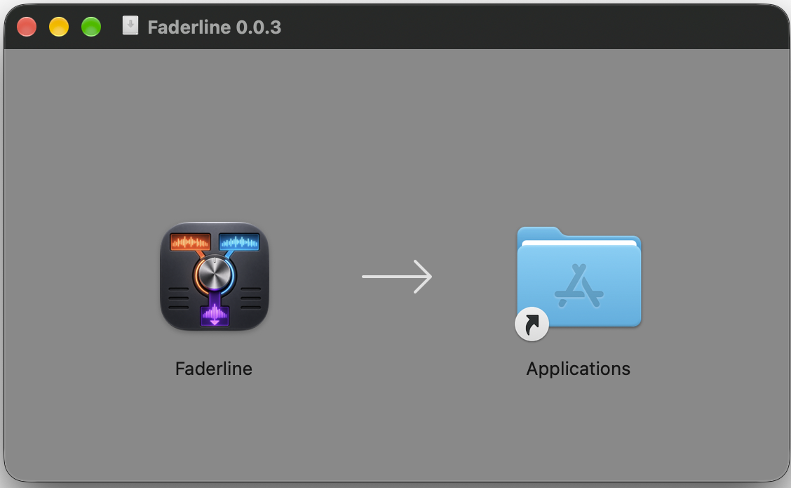
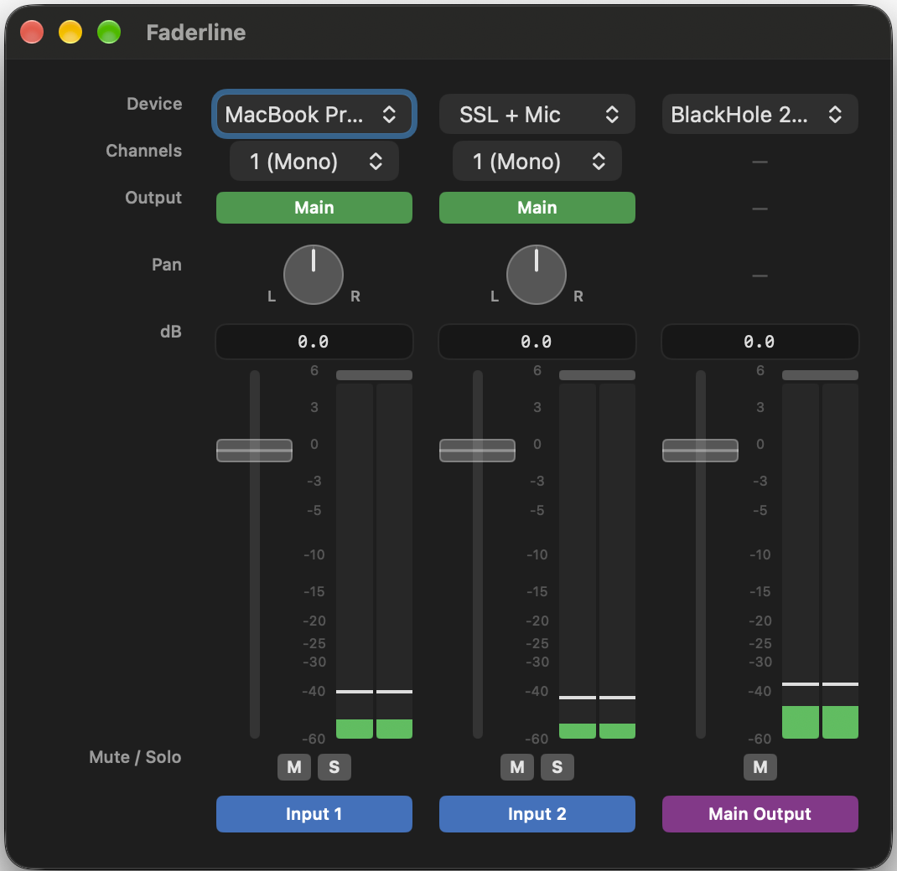

# Getting started with Faderline

Start with one source, check that you can hear it, then build your mix from there.
You don't need to build the app or know how its audio engine works.

## Before you start

You'll need macOS 15 (Sequoia) or later on an Apple Silicon Mac, an available
audio input, and an output you can listen through. Faderline also needs
microphone permission to capture audio, including audio from an interface.

Use **headphones for a live microphone**. Playing a microphone through nearby
speakers can cause loud feedback. Keep listening volume low while setting up,
and don't route an output back into its own input.

Faderline uses devices already available on your Mac. It doesn't automatically
capture sound from every app or install a virtual microphone driver. If your
setup needs a virtual device, arrange that separately before using it here.

## Download and install

1. Open the [signed v0.0.3 prerelease](https://github.com/efdo/AudioMixer/releases/tag/v0.0.3).
   Under **Assets**, download the DMG, not the source-code ZIP. This existing
   release uses the original longer asset name; new releases use
   `Faderline-<version>.dmg`. Check the release notes to confirm signing status.
2. Open the downloaded DMG and drag **Faderline.app** to **Applications**.
3. Eject the disk image and open Faderline from Applications.

*Faderline 0.0.3 disk image. Use the signed, notarized download linked above.*

The v0.0.3 release is signed and notarized, but is still labeled a **prerelease**.
[All releases](https://github.com/efdo/AudioMixer/releases) also lists other
versions. Files marked `unsigned-development` are for trusted development,
not the recommended first-time download.

## Open for the first time

macOS may ask whether you want to open an app downloaded from the internet.
For the signed download above, choose **Open** in that normal confirmation.
If macOS instead says the app is damaged or cannot be verified, check that you
downloaded the signed DMG from this repository's release page. Don't disable
macOS security protections to get past an unexpected warning.

When asked for microphone access, choose **Allow**. If you previously declined,
see [microphone permission](#if-something-is-missing-or-silent) below.

## Make your first mix

The window has **Input 1**, **Input 2**, and **Main Output** strips. The labels
down the left identify each row of controls.

*Faderline 0.0.3. Meter levels vary with the signal and device.*

1. In **Input 1**, use the **Device** picker to choose your input.
2. In **Channels**, select the channel carrying your sound:
   **1 (Mono)** for channel 1, **2 (Mono)** for channel 2, or
   **1 - 2 (Stereo)** for a stereo pair. Only presets supported by the device
   appear. A mono preset sends that channel to both sides of the mix.
3. In **Main Output**, choose your listening device in the **Device** row.
4. Ensure Input 1's **Main** button in the **Output** row is active.
   This sends the strip to Main Output.
5. Leave pan centered and **M** (mute) and **S** (solo) off. Set Input 1's
   fader to **0 dB**, which leaves its level unchanged. Keep the Main Output
   fader and your listening device's volume low.
6. Produce a real signal at your source. Watch the input meter, then raise
   Main Output gently until you can hear comfortably.

Leave Input 2 at **N/A** until you want another source. To add one, repeat the
input steps there. Don't add the same source twice unless you intend to mix
two copies: that can make it unexpectedly louder. The Main Output strip
controls the combined mix.

## Adjust your mix

| Control | What to do |
|---|---|
| Fader | Drag up or down to adjust level. Hold Shift while dragging for smaller changes. Double-click to return to 0 dB. The bottom is silence; the top is +6 dB. |
| dB field | Type an exact level and press Return. Negative values make it quieter; 0 dB is unchanged level, not silence. |
| Pan | Drag the knob vertically to move sound left or right. Double-click to center it. |
| Main | Turn an input's routing to Main Output on or off. |
| M | Silence that strip. Main Output's M silences the whole mix. |
| S | Hear the soloed inputs without the non-soloed inputs. Turn all S buttons off to return to the full mix. |
| Meter | The bars show signal level; the small peak markers briefly hold recent peaks. Input meters show incoming signal even when a fader, mute, or routing setting silences the mix. Main Output shows the final output level. |
| Clip light | The light above the meter stays lit after an overload. Reduce excessive source or mix levels, then click the light to clear it. Clearing it doesn't fix the overload. |

Main Output has no channel preset, pan, input-routing button, or solo button;
the dashes in those rows are normal.

Device selections, channel choices, levels, pan, input mute, and routing are
remembered. Solo and Main Output mute reset when you reopen the app.

## Update Faderline

Updates are manual; Faderline has no automatic updater.

1. Choose **Faderline > Quit** or press **Command-Q**, and wait for the app
   to exit normally.
2. Download and open the new signed DMG.
3. Drag Faderline to Applications and confirm replacing the old copy.
4. Eject the image and reopen Faderline from Applications.

Don't replace a running app or force-quit it to update. Your saved mix settings
normally remain. Updating Faderline doesn't install, update, or remove any
separately installed audio driver.

## If something is missing or silent

| What you see | What to check |
|---|---|
| N/A in Device | No device is selected. Choose the intended input or output from that picker. |
| Device missing from the picker | Check its connection and whether macOS recognizes it. If necessary, quit Faderline normally and reopen it after reconnecting. |
| Microphone access denied | Use the alert's **Open System Settings** button, or open **System Settings > Privacy & Security > Microphone**. Enable Faderline, then quit and reopen it normally. |
| No input meter activity | Produce a signal, check the selected device and channel preset, and check microphone permission. Very quiet signals may barely register. |
| Input meter moves, but no sound | Check the Main routing button, input and output M buttons, any active S buttons, both faders, and your selected output's own listening volume. |
| Error banner keeps appearing | Note its exact text and [report the problem](https://github.com/efdo/AudioMixer/issues), including Faderline/macOS versions and a brief description of your setup. Remove personal details from screenshots or logs before sharing. |

## More information

Return to the [README](../README.md) for the project overview and developer
information. The [release guide](RELEASING.md) is for maintainers building and
publishing packages, not a prerequisite for using Faderline.
